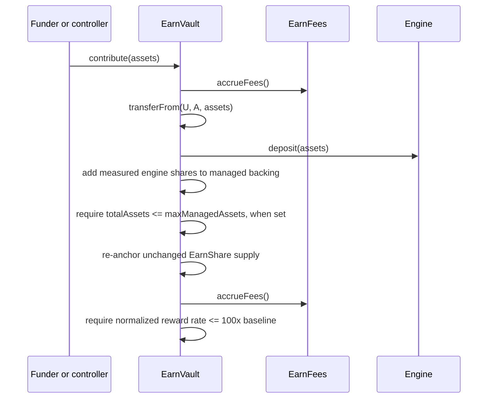

# End-to-end flows

This page is the transaction-order reference for the core stack. Capability sequences (private
routing, Veda queues, rewards, and migration) are on their
[capability module pages](../README.md#capability-modules). Amounts are named by unit
([units](system.md#units)).

## Participants

| Label | Contract or actor                                      |
| ----- | ------------------------------------------------------ |
| `U`   | Public user, private Zone account, operator, or funder |
| `A`   | `EarnVault`                                            |
| `F`   | EarnVault-bound `EarnFees`                             |
| `T`   | EarnShare                                              |
| `E`   | Current engine                                         |
| `V`   | Yield venue                                            |

Every economic action starts with the same checkpoint: `A` calls `F.accrueFees()`, mints any
returned `totalFeeEarnShares` to `F`, reconciles managed engine shares against raw custody, and
restates the anchor ([accrual checkpoints](fees.md#accrual-checkpoints),
[accounting anchors](system.md#accounting-anchors)). Every action ends by restating the anchor.
Every economic EarnVault call holds its reentrancy lock, and any failed step reverts the whole call.

## Self-recipient public calls

The [self-recipient overloads](../reference/contracts.md#user-and-accounting-api) follow the same
sequences with the receiver fixed to `msg.sender`; for a direct Tempo access-key transaction, that is
the account authorizing the key.

## Direct public deposit

```mermaid
sequenceDiagram
    participant U as User
    participant A as EarnVault
    participant F as EarnFees
    participant E as Engine
    participant V as Venue
    participant T as EarnShare

    U->>A: deposit(assets, receiver, minEarnShares)
    A->>F: accrueFees()
    F-->>A: FeePreview
    A->>T: mint(F, totalFeeEarnShares)
    A->>A: reconcile managed shares; require backing if supply is nonzero
    A->>A: transferFrom(U, A, assets); approve E for assets
    A->>E: deposit(assets)
    E->>V: deposit(assets, E)
    E-->>A: reported engineShares
    A->>A: require reported == measured raw-share increase
    A->>A: convert at the pre-entry anchor; check minEarnShares and 1-bp floor loss
    A->>T: mint(receiver, earnShares)
    A->>A: keep only represented shares managed; re-anchor
    A->>A: require totalAssets <= maxManagedAssets, when set
    A->>F: initializeBaselines()
```

The caller supplies nonzero `assets` and `minEarnShares` and a nonzero receiver; the pause must be
off. The EarnVault rejects the deposit with `ActiveSupplyWithoutBacking` when supply exists but
managed backing is worth zero. It converts the measured engine shares at the anchor in force before
entry, rejects a result below `minEarnShares` or one that leaves more than one basis point of the
received engine shares unrepresented, mints to the receiver, and leaves any unrepresented remainder
as surplus. The managed-assets limit is checked against post-deposit managed value, so concurrent
inflows cannot overfill it. Finally `F` ratchets its baselines so pooled precision is not yield
([high-water mark and target](fees.md#high-water-mark-and-target)).

## Direct public redemption and exact withdrawal

The current engine must advertise the matching capability; otherwise the call reverts with
`EngineCapabilityUnsupported`. Neither path checks the deposit pause or the managed-assets limit.

For share-denominated redemption, `redeem(earnShares, receiver, minAssets)` with nonzero
`minAssets`:

1. `A` checkpoints fees.
2. `A` pulls `earnShares` from the caller and burns it.
3. `A` converts the amount to engine shares at the anchor, rounding down.
4. `E.redeem(engineShares, receiver, minAssets)` pays the receiver directly and returns the
   receiver's measured asset increase; the engine verifies its exact venue-share decrease.
5. `A` checks the result against `minAssets`, removes the engine shares from managed backing, and
   re-anchors.

For asset-denominated withdrawal, `withdrawExact(assets, receiver, maxEarnShares)`:

1. `A` checkpoints fees.
2. `E.previewWithdraw(assets)` returns the required engine shares.
3. `A` converts them to EarnShare, rounding up, and checks `maxEarnShares`.
4. `E.withdraw(assets, receiver)` pays the receiver exactly `assets` and returns the measured
   venue-share decrease.
5. `A` removes that decrease from managed backing and converts it to `earnSharesBurned`, rounding up,
   and checks `maxEarnShares` again.
6. `A` reverts with `ResidualBacking` if the withdrawal consumes every managed engine share while
   paying less than their value, or would burn the entire supply while managed backing remains.
7. `A` pulls and burns `earnSharesBurned` from the caller and re-anchors; unused EarnShare stays
   with the caller.

The final holder closes the pool with `redeem`.

## Existing ERC-4626 share entry

`depositVenueShares` requires the current engine to advertise `IEarnEngineInKindDeposit`;
`ERC4626Engine` is the only implementation and accepts only its immutable venue token.

```mermaid
sequenceDiagram
    participant U as Existing venue holder
    participant A as EarnVault
    participant F as EarnFees
    participant E as ERC4626Engine
    participant T as EarnShare

    U->>E: approve venue token to E for venueShares
    U->>A: depositVenueShares(venueShares, receiver, minEarnShares)
    A->>F: accrueFees()
    A->>A: reconcile; require backing if supply is nonzero; require capability
    A->>E: depositInKind(venueShares, U)
    E->>U: transferFrom(U, E, venueShares)
    E-->>A: measured received shares
    A->>A: require reported == measured raw-share increase
    A->>A: convert; check minEarnShares and 1-bp floor loss
    A->>T: mint(receiver, earnShares)
    A->>A: keep only represented shares managed; re-anchor; check maxManagedAssets
    A->>F: initializeBaselines()
```

The rules match a base-asset deposit: the EarnVault checkpoints before principal enters, mints
proportional EarnShare, and ratchets fee baselines afterward. It never holds the venue token.

## Public and source-vault composition

Public callers use the EarnVault directly. A holder leaving another vault composes its own
redemption, an EarnVault deposit, and an optional Zone deposit in one Tempo Transaction
([source-vault composition](../modules/migration.md#source-vault-composition)).

## Private callback routing

Private deposits, redemptions, and spends run through the stack's `SingleZoneEarnRouter` as
authenticated Zone withdrawal callbacks that call the EarnVault's public `deposit`, `redeem`, and
`withdrawExact`. Their sequence, par conversion, and failure behavior are in
[Tempo Zones](../modules/zone-router.md#private-flows).
The EarnVault never stores, approves, or executes a swap.

## Fee accrual and claim

```mermaid
sequenceDiagram
    participant C as Any caller
    participant A as EarnVault
    participant F as EarnFees
    participant T as EarnShare
    participant R as Fee recipient

    C->>A: accrueFees()
    A->>F: accrueFees()
    F->>F: run waterfall; update baselines, remainders, and ledgers
    F-->>A: FeePreview(totalFeeEarnShares)
    A->>T: mint(F, totalFeeEarnShares)
    A->>A: reconcile and re-anchor
    R->>F: claim(to, earnShares)
    F->>T: transfer(to, earnShares)
```

The EarnVault mints only the amount its module returns, and a recipient can claim only its own
`claimableEarnShares`. Operator `setFeeConfig` and distributor `scheduleDistributorFeeUpdate`, then
after the delay a permissionless `executeDistributorFeeUpdate`, each require a fresh valuation,
checkpoint the old terms, and then install the new configuration
([configuration and authority](fees.md#configuration-and-authority)).

## Contribution



`contribute` requires the pause off, nonzero `assets`, and nonzero supply (`NoEarnShares`). The
funder receives no EarnShare; active holders, not open async claims, receive the exchange-rate
increase. The second checkpoint applies configured fees to the contribution. A call that would
exceed the managed-assets limit or the fixed 100× rate ceiling reverts completely.

`absorbEngineShareSurplus(engineShares)` follows the same sequence without moving tokens: after the
first checkpoint it moves up to the available surplus into managed backing
(`InsufficientEngineShareSurplus` otherwise), then applies the same capacity check, re-anchor, second
checkpoint, and rate check. Until absorbed, surplus is excluded from active NAV and fees.

Optional supply-bounded orchestration around `contribute` is in
[rewards](../modules/rewards.md#optional-controller).

## Async redemption

### Request

1. The caller approves `earnShares` to the EarnVault and calls
   `requestRedeem(earnShares, receiver, engineData)`; the engine must advertise
   `IEarnEngineAsyncRedeem`.
2. `A` checkpoints fees.
3. `A` converts the EarnShare to engine shares, rounding down, and reverts with
   `ExcessiveConversionLoss` if converting them back leaves more than one basis point of the
   EarnShare unrepresented.
4. `A` pulls and burns the EarnShare, asks the engine to queue the engine shares with `engineData`,
   and removes them from managed backing.
5. `A` records the requester, receiver, burned EarnShare, and engine shares under the engine's
   request ID, rejecting a duplicate ID.
6. If fees are active and the valuation is fresh, `F.recordRedeemRequest` stores the request's fee
   snapshot ([queued withdrawals](fees.md#queued-withdrawals)).
7. `A` increments `openRedeemRequestCount` and re-anchors; active supply and NAV exclude the claim.

The deposit pause does not block requests. Engine-specific request data and validation, such as
Veda's tracking-Queue readback and absolute payout floor, are on the
[Veda page](../modules/veda.md#queued-exits).

### Finalization

The venue delivers assets to the engine, which transfers them to the EarnVault and calls
`finalizeRedeem(requestId, asset, amount)`. The EarnVault requires the caller to be its current
engine, the asset to be its base asset, and the request to be open. It closes the claim, decrements
`openRedeemRequestCount`, closes the fee snapshot, forwards `amount` to the stored receiver, and, if
the receiver has code, calls `onRedeemFinalized` inside a `try`, so a reverting receiver cannot block
finalization. There is no burn or fee checkpoint. Veda's forwarding solver makes the venue solve,
measured engine credit, and finalization atomic
([Veda queued exits](../modules/veda.md#queued-exits)).

### Cancellation

The requester or the async janitor calls `cancelRedeem(requestId, minReceiverEarnShares)` with a
nonzero minimum. The EarnVault:

1. checkpoints active-pool fees and reads whether the snapshot will be charged and, if so, the active
   pool's assets and supply;
2. asks the engine to cancel, measures the returned raw engine shares, and adds them to managed
   backing;
3. closes the claim and decrements `openRedeemRequestCount`;
4. values the returned shares when the snapshot is charged, and computes the re-entry EarnShare;
5. asks `F.settleCancelledRedeem` for the fee portion and mints it to `F`;
6. checks the 1-bp conversion bound for a nonempty pool and `minReceiverEarnShares`, and mints the
   rest to the stored receiver;
7. re-anchors; and
8. if the receiver has code, calls `onRedeemCancelled` inside a `try`.

Neither caller can redirect the result. The re-entry formula, snapshot waiver, and empty-pool
baselines are in [queued withdrawals](fees.md#queued-withdrawals).

## Engine migration and stack replacement

Whole-pool `migrateEngine` on `OperatorEnabled` stacks and per-holder stack replacement on
`UserOnly` stacks are sequenced in
[existing vault migration](../modules/migration.md#whole-pool-engine-migration).
