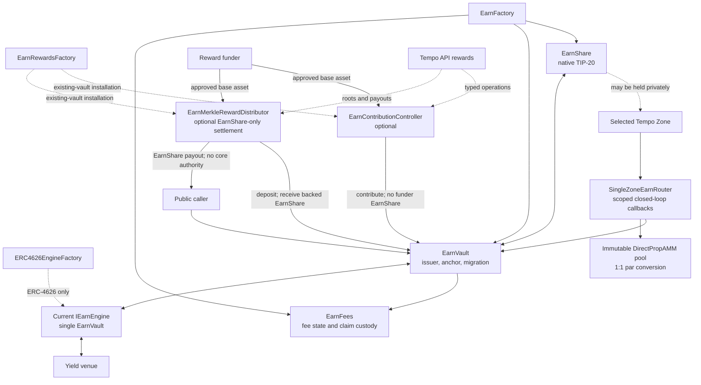

# System architecture

This page is the accounting specification of the core stack: what each contract owns, how active
backing, quarantined surplus, and pending claims stay separate, who may change what, and which tests
enforce each invariant. Fee economics are in [Earn fees](fees.md), transaction order in
[flows](flows.md), trust assumptions in [security and privacy](security-and-privacy.md), and function
signatures in the [contract reference](../reference/contracts.md). Audit coverage is on the
[audits page](../audit/README.md).

## Goal

Tempo Earn gives every customer the same onchain shape for vault-backed yield. A native,
non-rebasing TIP-20 EarnShare represents ownership. A persistent `EarnVault` is its sole issuer and
keeps accounting stable when the yield venue changes. One current engine holds the venue shares. An
ownerless `EarnFees` module holds fee state and fee custody. An optional ownerless router adds
closed-loop private deposits and redemptions, and private payments to admitted destinations, from
one Tempo Zone.

The architecture has four layers:

1. **Core stack:** EarnShare, `EarnVault`, `EarnFees`, and one current engine.
2. **Yield integration:** a single-EarnVault engine that exclusively holds venue shares.
3. **Private routing:** one ownerless, immutable `SingleZoneEarnRouter` per Zone-connected stack.
4. **Optional periphery:** `EarnContributionController`, `EarnMerkleRewardDistributor`, and the Veda
   registry and forwarding solver.

## Scope

The repository implements:

- atomic factory creation of EarnShare, a non-upgradeable EarnVault proxy, and a deterministic
  `EarnFees` clone;
- base-asset deposit, EarnShare redemption, exact-asset withdrawal, and permissionless contribution;
- an optional operator-set cap on active managed assets after voluntary inflows;
- in-kind entry with the current venue's shares, which only `ERC4626Engine` supports;
- deployment-fixed, same-asset whole-pool engine migration;
- immediate ERC-4626 execution through `ERC4626Engine`;
- immediate and queued Veda exits through `VedaEngine`;
- experimental immediate execution against a DirectPropAMM pool through `PropAMMEngine`;
- same-source-Zone private callbacks through `SingleZoneEarnRouter`, converting a different private
  asset at exact 1:1 par through one immutable DirectPropAMM pool, and optionally paying admitted
  parent-chain destinations;
- optional one-way contribution orchestration; and
- an optional EarnShare settlement rail for offchain-computed cumulative reward entitlements.

It does not implement an end-user API, identity provider, portfolio allocator, or customer-specific
commercial policy. Contracts in `src/demo/` are test infrastructure.

## Units

Amounts on these pages are named by unit ([glossary](../glossary.md) for other terms):

| Term           | Meaning                                                                                                                                                              |
| -------------- | -------------------------------------------------------------------------------------------------------------------------------------------------------------------- |
| Earn stack     | One EarnShare, `EarnVault`, `EarnFees`, and current engine.                                                                                                          |
| `earnShares`   | EarnShare token units.                                                                                                                                               |
| `engineShares` | The current engine's raw custody units (`IEarnEngine.totalShares`).                                                                                                  |
| `venueShares`  | The token an engine holds: ERC-4626 or BoringVault shares, or a DirectPropAMM pool's base token. Every implemented engine counts one engine share as one unit of it. |
| `assets`       | Units of the EarnVault and engine's immutable base asset.                                                                                                            |

## Topology



## Core responsibilities

### EarnShare

EarnShare is created by the canonical Tempo TIP-20 factory. It is non-rebasing: yield changes the
assets each EarnShare redeems for, not holder balances. The factory names it after the engine
(`"<engine name> (Earn)"`, symbol `"<engine symbol>E"`) and gives it an empty currency, so an
EarnShare is never treated as a USD stablecoin for fee payment or the stablecoin DEX.

`EarnVault` is the sole issuer. During creation the factory administers the TIP-20, grants the
EarnVault issuer membership, attaches the transfer policy, and then revokes its own administrator
role without installing a replacement. No live account can add an issuer or change the policy ID.
Neither `EarnFees`, an engine, the router, nor optional periphery holds mint or burn authority.

A protected deployment attaches an existing simple TIP-403 whitelist that governs minting, holding,
transfers, and exits ([access policy](../modules/access.md)); an open deployment keeps the
always-allow policy `1`.

### EarnVault

`EarnVault` is the persistent per-stack state boundary. It:

- fixes the base asset, EarnShare, and `EarnFees` at initialization;
- stores the operator, optional fee distributor and its protected fixed-fee item, the
  deployment-fixed distributor update delay, and the deployment-fixed migration mode;
- exclusively mints and burns EarnShare;
- holds the engine-share conversion anchor and the managed engine-share count;
- checkpoints fees before every economic action;
- coordinates deposits, in-kind entry, exits, contributions, and surplus absorption;
- rejects voluntary inflows that would exceed its managed-assets limit;
- stores each open async claim's requester, receiver, burned EarnShare, and queued engine shares;
- coordinates whole-pool engine migration when the deployment permits it; and
- holds the emergency guardian and async janitor seats.

It does not hold venue shares, store route policy, or execute swaps, and between calls it holds no
base assets. Each EarnVault is an ERC-1967 proxy with isolated storage pointing at the factory's
locked implementation; neither has an upgrade entrypoint.

### EarnFees

Every EarnVault has exactly one deterministic, ownerless `EarnFees` clone holding versioned fee
configurations, the high-water mark and target, rounding remainders, recipient claim ledgers, and
async-request fee snapshots. Only its EarnVault may mutate it, and only the EarnVault mints the fee
EarnShare it calculates. Its rules are in [Earn fees](fees.md).

### Yield engines

An engine serves one EarnVault, uses the same immutable base asset, and holds the venue shares. The
EarnVault separately records how many of those raw shares are managed backing for active EarnShare;
any raw shares above that count are quarantined surplus. After its one-time binding, only the
EarnVault can change the venue position. The engine interface, ERC-165 capabilities, installation
rules, and each engine's behavior are in [yield engines](../integrations/engines.md).

### EarnFactory

`EarnFactory` holds immutable locked `EarnVault` and `EarnFees` implementations and creates
EarnShare, the EarnVault proxy, and its `EarnFees` clone atomically around an already-deployed,
unbound engine, which the engine's setup owner then binds. The creation sequence is in the
[contract reference](../reference/contracts.md#earnfactory).

## Private routing

An optional ownerless `SingleZoneEarnRouter`, deployed after its EarnVault, lets accounts in one
Tempo Zone deposit, redeem, and optionally pay admitted destinations through authenticated
withdrawal callbacks, converting a fixed private asset at exact par when it differs from the vault
asset. It holds no economic state and has no
authority over the EarnVault, which stores no route configuration. Its contract, flows, and trust
boundaries are in [Tempo Zones](../modules/zone-router.md).

## Optional periphery

`EarnContributionController` and `EarnMerkleRewardDistributor` hold no EarnShare issuer or
EarnVault configuration authority; `EarnRewardsFactory` installs them on an existing EarnVault. They
are specified in [rewards](../modules/rewards.md).

## Custody model

| Asset or state                  | Custodian                                                     |
| ------------------------------- | ------------------------------------------------------------- |
| Active backing                  | Current engine, as managed venue shares                       |
| Quarantined venue-share surplus | Current engine; excluded from active Earn accounting          |
| Public EarnShare                | User or integration                                           |
| Private EarnShare               | Zone Portal on Tempo, represented privately in the Zone       |
| Open async claim                | EarnVault record and engine queue; fee snapshot in `EarnFees` |
| Unclaimed fee EarnShare         | `EarnFees`                                                    |

Engines, the router, and reward periphery document their own transient or engine-specific custody on
their [module pages](../README.md#capability-modules).

## Accounting anchors

### Conversion anchor

The EarnVault converts between EarnShare and engine shares at the stored anchor
`anchorEngineShares : anchorEarnShares`, using floor rounding except where an exact withdrawal
rounds the EarnShare charge up. Whenever supply or managed backing is zero, including at
initialization, the anchor resets to whole units of each token:

```text
anchorEngineShares = engine.shareScale()
anchorEarnShares   = 10 ** EarnShare.decimals()
```

Every economic action ends by restating the anchor from actual state, so after each action:

```text
convertToEngineShares(totalEarnShares()) == engineShares()
```

`isAccountingAligned()` reports this equality. Deposits and exits change backing and supply
proportionally. Fee mints add supply without backing; contributions and surplus absorption add
backing without supply; engine migration changes the engine-share count without changing supply.
Each restates the anchor against the resulting pair.

### Managed backing and quarantined surplus

`engineShares()` is the managed count, capped at the engine's raw `totalShares()`;
`surplusEngineShares()` is any raw custody above it. `totalAssets()` values only managed shares,
so surplus does not affect fees, quotes, deposits, or exits.

- An engine deposit's reported shares must equal the measured raw-share increase. A principal entry
  then keeps as managed only the engine shares its minted EarnShare represents; the floor-rounding
  remainder stays surplus.
- Engine shares transferred directly to the engine stay surplus. Anyone may call
  `absorbEngineShareSurplus` to recognize some of it as a reward, subject to the deposit pause, the
  managed-assets limit, and the reward-admission limit.
- Every fee checkpoint first reconciles managed shares against raw custody. If raw custody has
  fallen below the managed count, the managed count drops to it and the EarnVault emits
  `EngineShareShortfallReconciled` with the previous managed count, observed custody, shortfall, and
  EarnShare supply. Treat that event as a critical engine-custody signal: pause new exposure and
  investigate while preserving exits. A falling share price alone does not emit it.
- Migration moves surplus with managed backing and preserves the managed/surplus split in the new
  engine's units ([whole-pool migration](../modules/migration.md#whole-pool-engine-migration)).

If managed backing is worth zero while EarnShare supply is nonzero, `deposit` and
`depositVenueShares` revert with `ActiveSupplyWithoutBacking` rather than recapitalize existing
holders from a new depositor's principal. `contribute` remains the shareless path for a funder that
intentionally restores backing.

### Reward-admission limit

`normalizedRewardRate()` is managed engine shares per whole EarnShare, rounded up.
`rewardRateBaseline()` records that rate at initialization, at every reset to an empty anchor, and
after every migration. A `contribute` or `absorbEngineShareSurplus` call that leaves the rate, after
its fee checkpoint, above `MAX_REWARD_RATE_MULTIPLIER` (100) times the baseline reverts with
`RewardRateLimitExceeded`. The multiplier is a constant with no setter.

This is an admission check, not a global invariant. Principal entry and exits are never checked
against it: exits keep all remaining holder backing managed even if rounding moves the rate above
100×, and later rewards stay blocked until fee dilution or a pool reset restores headroom. Venue
yield does not move the rate, because it raises the value of each engine share rather than their
number. Rewards compounding at 7% a year would take about 68 years to reach 100×.

Exit rounding can be compounded deliberately. `withdrawExact` rounds the EarnShare it burns up, so
a holder of the whole active supply can alternate exact withdrawals with `depositVenueShares` and
ratchet the rate: with a 6-decimal asset over an 18-decimal venue, 25 rounds raise it about 16.7
million×. Rewards are then blocked, and a later deposit reverts with `ExcessiveConversionLoss` once
one EarnShare unit is worth more than its 1-basis-point loss bound allows. The holder keeps the value
it moved, so this costs only gas, but it needs the whole supply: it affects a new or emptied pool
before other holders enter.

An async request removes its EarnShare and engine shares from the active pool. A request that
empties the pool resets the baseline like any empty anchor, and a cancellation that reopens the pool
keeps that reset baseline. Before any migration the reopened rate matches it, so the cycle creates no
headroom. After a migration to an engine that counts its shares differently, the migrated baseline
is lost: the reopened rate stays at the migrated level against the reset baseline, which blocks
rewards when the new engine issues more shares per EarnShare and widens headroom when it issues
fewer.

### Managed-assets limit

When `maxManagedAssets` is nonzero, `deposit`, `depositVenueShares`, `contribute`, and
`absorbEngineShareSurplus` revert with `MaxManagedAssetsExceeded` if managed backing would end above
it. The operator may change it at any time; zero means unlimited. A limit below current backing
forces no exit; voluntary inflows stop until exits create room or the operator raises or removes
it. Passive yield may carry backing above the limit. Redemption, exact withdrawal, async requests
and cancellation, and migration never check it. `remainingDepositCapacity()` quotes the room left.

Fee treatment of checkpoints, stale valuation, and queued claims is in [Earn fees](fees.md);
transaction order is in [flows](flows.md).

## Roles and authority

| Authority                    | Scope                                                                                                                                                             |
| ---------------------------- | ----------------------------------------------------------------------------------------------------------------------------------------------------------------- |
| EarnShare issuer             | EarnVault only; membership is frozen once factory creation returns                                                                                                |
| TIP-403 policy administrator | Whitelist membership only; cannot alter EarnShare issuer membership                                                                                               |
| EarnVault operator           | Pause and unpause, managed-assets limit, emergency seats, ordinary fees, global fee disable without a distributor, permitted migration, two-step operator handoff |
| Fee distributor              | Delayed updates to its protected fixed-fee item, two-step distributor handoff                                                                                     |
| Emergency guardian           | Pause deposits, in-kind entry, contributions, and surplus absorption; never unpause                                                                               |
| Async janitor                | Cancel an open request; the result goes only to its stored receiver                                                                                               |
| Engine setup owner           | One-time EarnVault binding, optionally with an atomic transfer to the final owner                                                                                 |
| Final engine owner           | Engine-specific operational settings                                                                                                                              |
| Anyone                       | `accrueFees`, `contribute`, `absorbEngineShareSurplus`, and a ready `executeDistributorFeeUpdate`                                                                 |

`EarnFees` and `SingleZoneEarnRouter` have no owner. The role-bearing seats need not share one
account; a zero guardian or janitor leaves that seat empty. Engine-specific roles, such as Veda's
BoringVault owner and forwarding-solver owner, are on each [engine's
page](../integrations/engines.md).

## Core invariants

1. `EarnVault` is the only EarnShare issuer.
2. Each EarnVault is permanently paired with one EarnShare and one `EarnFees`.
3. `EarnFees` cannot mint or configure itself, and its EarnShare balance covers every recorded
   claim.
4. The operator cannot remove or change a configured distributor's protected fixed-fee item, and
   neither authority can push aggregate fixed fees above 10,000 bps.
5. One engine serves one EarnVault and uses its base asset.
6. The current engine, never the EarnVault, holds venue shares.
7. Active supply is backed only by managed engine shares at the current anchor; open claims are
   separate.
8. A deposit pause never blocks immediate redemption, exact withdrawal, or async request,
   finalization, and cancellation.
9. Immediate exits enforce caller bounds, and EarnShare burns follow measured receiver-asset and
   venue-share deltas, not venue return values.
10. An async request pays its finalization and cancellation only to its one stored receiver.
11. Whole-pool migration is same-asset, atomic, bounded, preserves EarnShare supply and balances, and
    is blocked while claims are open.
12. Contributions mint no funder EarnShare, checkpoint fees before and after, and re-anchor measured
    backing.
13. In-kind entry works only through an engine advertising `IEarnEngineInKindDeposit` and checkpoints
    fees before principal enters.
14. Async request conversion and nonempty-pool cancellation re-entry leave at most one basis point of
    their input unrepresented and never over-represent returned engine shares.
15. Fees never exceed positive accrual above the high-water mark, so deposited principal is never a
    fee base, and fee EarnShare allocations sum exactly to the amount minted.

### Enforcing tests

Each row lists, by invariant number, the tests whose assertions check that invariant; a parenthesis
names the part a test covers. Stateful suites assert every `invariant_*` function after each handler
call; the E2E case runs against a deployed stack ([E2E environments](../operations/e2e-environments.md)).

| #   | Kind      | Enforcing tests                                                                                                                                                                                                                                                                                                                                                                                                                                                                                                                                                                                                                                                                                                                                                                                                                                                                        |
| --- | --------- | -------------------------------------------------------------------------------------------------------------------------------------------------------------------------------------------------------------------------------------------------------------------------------------------------------------------------------------------------------------------------------------------------------------------------------------------------------------------------------------------------------------------------------------------------------------------------------------------------------------------------------------------------------------------------------------------------------------------------------------------------------------------------------------------------------------------------------------------------------------------------------------- |
| 1   | Unit      | [`EarnFactory.t.sol`](../../test/core/EarnFactory.t.sol): `testDeployCreatesEarnStackAndRelinquishesEarnAdmin`, `testDeployFreezesIssuerMembershipAndRejectsUnauthorizedMint`; [`EarnVaultCore.t.sol`](../../test/core/EarnVaultCore.t.sol): `testInitialEarnShareSupplyNotZero` (no supply minted before the EarnVault)                                                                                                                                                                                                                                                                                                                                                                                                                                                                                                                                                               |
| 2   | Unit      | [`EarnFactory.t.sol`](../../test/core/EarnFactory.t.sol): `testDeployCreatesEarnStackAndRelinquishesEarnAdmin`, `testDeployedStackCannotBeReinitialized`; [`EarnVaultFees.t.sol`](../../test/core/EarnVaultFees.t.sol): `testProxyCanOnlyInitializeOnce`, `testEarnFeesMutationsAreRestrictedToItsImmutableEarnVault`                                                                                                                                                                                                                                                                                                                                                                                                                                                                                                                                                                  |
| 3   | Invariant | [`EarnVaultInvariant.t.sol`](../../test/core/EarnVaultInvariant.t.sol): `FeeEarnVaultInvariantTest.invariant_feeCustodyEqualsRecordedClaims`; [`ERC4626CompositionInvariant.t.sol`](../../test/engines/erc4626/ERC4626CompositionInvariant.t.sol): `invariant_feeCustodyEqualsRecordedClaims`                                                                                                                                                                                                                                                                                                                                                                                                                                                                                                                                                                                          |
| 3   | Unit      | [`EarnFactory.t.sol`](../../test/core/EarnFactory.t.sol): `testDeployCreatesEarnStackAndRelinquishesEarnAdmin` (no `EarnFees` issuer role); [`EarnVaultFees.t.sol`](../../test/core/EarnVaultFees.t.sol): `testEarnFeesMutationsAreRestrictedToItsImmutableEarnVault`, `testFixedFeeUsesCombinedYieldAndContributionsAndCanBeClaimed`                                                                                                                                                                                                                                                                                                                                                                                                                                                                                                                                                  |
| 4   | Unit      | [`EarnVaultFees.t.sol`](../../test/core/EarnVaultFees.t.sol): `testDistributorFeeIsProtectedFromOperatorUpdates`, `testEitherAuthorityCannotExceedAggregateFixedFeeLimit`, `testGlobalFeeDisableIsUnavailableWhenDistributorConfigured`, `testDistributorCanDisableAndLaterRestoreItsReservedItem`, `testConfigurationIsOperatorOnlyAndClaimsAreBounded` (operator bound without a distributor)                                                                                                                                                                                                                                                                                                                                                                                                                                                                                        |
| 5   | Unit      | [`EarnFactory.t.sol`](../../test/core/EarnFactory.t.sol): `testDeployRejectsAlreadyBoundEngine`, `testERC4626EngineSetupOwnerBindsFactoryStack`; [`ERC4626EngineFactory.t.sol`](../../test/engines/erc4626/ERC4626EngineFactory.t.sol): `testSetupOwnerBindsOnceAndHandsOff`; [`EarnVaultMigration.t.sol`](../../test/core/EarnVaultMigration.t.sol): `testMigrateRejectsAssetMismatch`, `testEmptyMigrationRejectsReplacementNotBoundToThisVault`; [`PropAMMEngine.t.sol`](../../test/engines/propamm/PropAMMEngine.t.sol): `testBindingIsOwnerOnlyOnceAndAssetChecked`                                                                                                                                                                                                                                                                                                               |
| 6   | Invariant | [`ERC4626CompositionInvariant.t.sol`](../../test/engines/erc4626/ERC4626CompositionInvariant.t.sol): `invariant_engineOwnsAllVenueShares`, `invariant_intermediateContractsRetainNoTokensOrApprovals`                                                                                                                                                                                                                                                                                                                                                                                                                                                                                                                                                                                                                                                                                  |
| 7   | Invariant | [`EarnVaultInvariant.t.sol`](../../test/core/EarnVaultInvariant.t.sol): `AsyncEarnVaultInvariantTest.invariant_activeSupplyExcludesPendingClaims`, `AsyncEarnVaultInvariantTest.invariant_engineAssetsCoverActiveAndPendingShares`, `FeeEarnVaultInvariantTest.invariant_feeAccrualPreservesBackingAlignment`; [`ERC4626CompositionInvariant.t.sol`](../../test/engines/erc4626/ERC4626CompositionInvariant.t.sol): `invariant_projectedEarnSupplyRedeemsToActualVenueAssets`                                                                                                                                                                                                                                                                                                                                                                                                          |
| 7   | Unit      | [`EarnVaultAsync.t.sol`](../../test/core/EarnVaultAsync.t.sol): `testAsyncBurnAtRequestInvariantAcrossRequestFinalizeCancel`, `testContributionWhileAsyncRequestOpenBenefitsOnlyActivePool`                                                                                                                                                                                                                                                                                                                                                                                                                                                                                                                                                                                                                                                                                            |
| 8   | Unit      | [`EarnVaultControls.t.sol`](../../test/core/EarnVaultControls.t.sol): `testGuardianPausesNewExposureWhileRedeemRemainsAvailable` (redemption), `testExactWithdrawalRemainsAvailableWhileDepositsPaused` (exact withdrawal), `testDepositPauseLeavesAsyncRequestsAvailableAndJanitorIsSeparateFromGovernance` (async request, finalization, and cancellation)                                                                                                                                                                                                                                                                                                                                                                                                                                                                                                                           |
| 8   | E2E       | [`controls`](../../e2e/modules/controls/module.ts) case `controls-operator-authority` (exact withdrawal and redemption while paused)                                                                                                                                                                                                                                                                                                                                                                                                                                                                                                                                                                                                                                                                                                                                                   |
| 9   | Unit      | [`ERC4626Engine.t.sol`](../../test/engines/erc4626/ERC4626Engine.t.sol): `testRedeemPaysMeasuredAssetsInsteadOfVenueReport`, `testRedeemRollsBackWhenVenueOverreportsReceiverDelivery`, `testRedeemRejectsUnexpectedVenueShareBurn`, `testWithdrawRejectsUnexpectedReceiverDelivery`, `testWithdrawChargesMeasuredVenueShareConsumption`; [`VedaEngineAccounting.t.sol`](../../test/engines/veda/VedaEngineAccounting.t.sol): `testRedeemRejectsTellerReturnWithoutReceiverDelivery`, `testRedeemRejectsFeeOnTransferUnderDelivery`, `testRedeemRejectsUnexpectedVenueShareBurn`, `testExactWithdrawRejectsFeeOnTransferDelivery`; [`EarnVaultCore.t.sol`](../../test/core/EarnVaultCore.t.sol): `testBoundedRedeemRevertsBelowMinimumAndRollsBack` (caller bound), `testExceedsMaxEarnSharesPreviewAndActual`, `testWithdrawExactBurnsOnlyConsumedEarnSharesAndLeavesUnusedEarnShare` |
| 10  | Unit      | [`EarnVaultAsync.t.sol`](../../test/core/EarnVaultAsync.t.sol): `testAsyncBurnAtRequestInvariantAcrossRequestFinalizeCancel`, `testCancelIsRequesterOrJanitorOnly`, `testFinalizeSucceedsEvenWhenReceiverCallbackReverts`; [`EarnVaultControls.t.sol`](../../test/core/EarnVaultControls.t.sol): `testDepositPauseLeavesAsyncRequestsAvailableAndJanitorIsSeparateFromGovernance`                                                                                                                                                                                                                                                                                                                                                                                                                                                                                                      |
| 11  | Unit      | [`EarnVaultMigration.t.sol`](../../test/core/EarnVaultMigration.t.sol): `testMigrateRejectsAssetMismatch`, `testMigrateRevertsIfDepositLegFailsAndPoolStaysOnOldEngine`, `testMigrateRejectsReplacementThatDoesNotConsumeAllAssets`, `testMigrateRejectsResidualOldEngineCustody`, `testMigrateRequiresAndEnforcesOutputBounds`, `testMigrateRejectsInflatedDestinationBelowRetainedAssetMinimum`, `testMigratePreservesSupplyNavAndBalancesAndReAnchors`; [`EarnVaultAsync.t.sol`](../../test/core/EarnVaultAsync.t.sol): `testMigrateRevertsWhileAsyncRequestsPending`                                                                                                                                                                                                                                                                                                               |
| 12  | Invariant | [`EarnVaultInvariant.t.sol`](../../test/core/EarnVaultInvariant.t.sol): `FeeEarnVaultInvariantTest.invariant_feeAccrualPreservesBackingAlignment` (re-anchor; the handler contributes)                                                                                                                                                                                                                                                                                                                                                                                                                                                                                                                                                                                                                                                                                                 |
| 12  | Unit      | [`EarnVaultCore.t.sol`](../../test/core/EarnVaultCore.t.sol): `testDepositMinimumEarnSharesPreventsContributionInflationAttack` (funder balance unchanged, backing recognized); [`EarnVaultVenueShares.t.sol`](../../test/core/EarnVaultVenueShares.t.sol): `testExistingVenueSharesMintAtCurrentEarnRate` (supply unchanged by the contribution); [`EarnVaultFees.t.sol`](../../test/core/EarnVaultFees.t.sol): `testFixedFeeUsesCombinedYieldAndContributionsAndCanBeClaimed` (fee checkpoint); [`EarnVaultAsync.t.sol`](../../test/core/EarnVaultAsync.t.sol): `testContributionWhileAsyncRequestOpenBenefitsOnlyActivePool` (re-anchor with an open claim)                                                                                                                                                                                                                         |
| 13  | Unit      | [`EarnVaultVenueShares.t.sol`](../../test/core/EarnVaultVenueShares.t.sol): `testExistingVenueSharesArePrincipalNotFeeableAccrual` (checkpoint before entry), `testExistingVenueSharesMintAtCurrentEarnRate`, `testInKindEntryRejectsEngineWithoutInKindCapability` (capability gate); [`EarnVaultFees.t.sol`](../../test/core/EarnVaultFees.t.sol): `testHigherPrecisionEngineNormalizesFirstInKindEntry`; [`ERC4626Engine.t.sol`](../../test/engines/erc4626/ERC4626Engine.t.sol): `testMutatingCallsAreOnlyEarnVault` (`depositInKind` is EarnVault-only)                                                                                                                                                                                                                                                                                                                           |
| 14  | Unit      | [`EarnVaultAsync.t.sol`](../../test/core/EarnVaultAsync.t.sol): `testAsyncRequestRejectsExcessiveFloorLossBeforeBurning` (request conversion), `testNonemptyPoolCancellationRejectsExcessiveFloorLoss` (cancellation re-entry), `testContributionWhileAsyncRequestOpenBenefitsOnlyActivePool` (the unrepresented returned engine share stays surplus)                                                                                                                                                                                                                                                                                                                                                                                                                                                                                                                                  |
| 15  | Invariant | [`EarnVaultInvariant.t.sol`](../../test/core/EarnVaultInvariant.t.sol): `FeeEarnVaultInvariantTest.invariant_previewNeverChargesMoreThanPositiveAccrual`                                                                                                                                                                                                                                                                                                                                                                                                                                                                                                                                                                                                                                                                                                                               |
| 15  | Fuzz      | [`EarnFeeMathFuzz.t.sol`](../../test/core/EarnFeeMathFuzz.t.sol): `testFuzzPreviewFeesStayWithinPositiveAccrualAndAllocateExactly`                                                                                                                                                                                                                                                                                                                                                                                                                                                                                                                                                                                                                                                                                                                                                     |
| 15  | Unit      | [`EarnFeeMathFuzz.t.sol`](../../test/core/EarnFeeMathFuzz.t.sol): `testCarriedFixedFeesCannotExceedPositiveAccrual`, `testPreviewCapsAggregateWhenCarriedRoundingExceedsAccrual`; [`EarnVaultVenueShares.t.sol`](../../test/core/EarnVaultVenueShares.t.sol): `testExistingVenueSharesArePrincipalNotFeeableAccrual` (principal entry)                                                                                                                                                                                                                                                                                                                                                                                                                                                                                                                                                 |

## Configuration boundaries

Fixed per stack:

- the EarnShare, EarnVault, and `EarnFees` pairing;
- the base asset;
- the EarnVault implementation, migration mode, and distributor update delay; and
- each engine's EarnVault, venue, and base asset.

Changeable only through the named role:

- the operator, through its two-step handoff;
- the current engine, through `migrateEngine` when the migration mode is `OperatorEnabled`;
- the managed-assets limit, deposit pause, and emergency seats;
- ordinary fee configuration, prospectively;
- the distributor, through its two-step handoff, and its protected fee item, through delayed
  updates; and
- global fee disablement, by the operator, only on stacks without a distributor.
