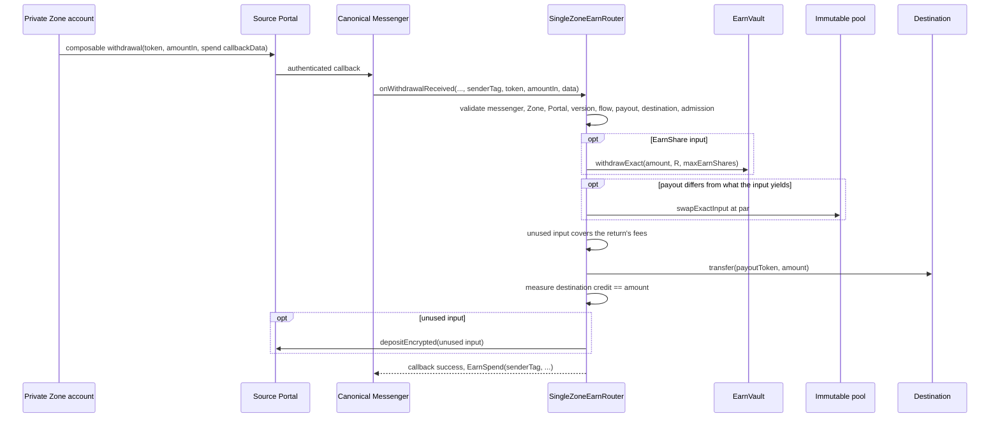

# Tempo Zones and private routing

This page owns the `zone-router` module: the `SingleZoneEarnRouter` contract, its callback flows
(private deposit, redemption, and spend), par conversion, Zone token enablement and admission,
router deployment and activation, client integration, failure handling, tests, and the Zone go-live
gate. Readers are integrators building private deposits, redemptions, and payments, operators
activating a router, and reviewers.

Zones are external infrastructure. Sigma Prime audited the DirectPropAMM pool contract; the router's
DirectPropAMM conversion and its same-asset mode changed after the audits
([coverage](../audit/README.md#coverage-after-the-audits)). Hosted Zone stacks are listed in
[hosted environments](../operations/hosted-environments.md).

## Router contract

[`SingleZoneEarnRouter`](../../src/router/SingleZoneEarnRouter.sol) lets an account inside a Zone
deposit into, or redeem from, one EarnVault on the parent chain and receive the result back in the
same Zone, or pay a parent-chain destination from its private balance. Each instance is ownerless
and immutable to one Zone ID, EarnVault, and private asset, and to whether it accepts spends
(`spendEnabled`); the vault asset and EarnShare are read from the EarnVault at construction. The private asset decides
the mode:

- **Conversion router.** A private asset other than the vault asset also binds one PropAMM pool and a
  nonzero `customerId` (the pool's rounding route and trade-memo identifier). `poolKind` says which
  pool: a single-pair DirectPropAMM (`Direct`, with a zero `pairIndex` and `sponsorId`), or one live
  pair of a ManagedDirectPropAMM (`Managed`), traded under `sponsorId`'s list (0 is the pair's home
  list). The pool's or pair's base and quote tokens must be exactly the private and vault assets, in
  either order (`privateAssetIsBase` records which), with equal decimals. Otherwise construction
  reverts `InvalidPool`, `InvalidCustomerId`, or `InvalidRoutePair`.
- **Same-asset router.** A private asset equal to the vault asset binds a zero pool, customer ID,
  pair, and sponsor, a `Direct` kind, and deposits and redeems that asset directly. Any other binding
  reverts `InvalidPrivateAsset`.

A Managed swap pays its caller, so the router is both taker and recipient. Admission is the pair's
taker check for the router under its sponsor list, and `liquidityStatus` reports a `Closed` or
removed pair as paused. Prices, freshness, and inventory are the pair's, priced exactly like a
DirectPropAMM.

`spendEnabled` turns on the [private spend](#private-spend) flow. A spend names its destination in
callback data, so one router serves every payee on its Zone, and a payee that changes its address
needs only the Zone's admission, not a new router.

The private asset may never be zero or the EarnShare. Zone ID zero makes every callback revert. The
router has no owner, registry, setters, public routing method, or rescue; its only state is a
reentrancy flag, and it holds no user position. Changing the Zone, EarnVault, private asset, pool, or
`spendEnabled` means deploying a new router; an old router stays deployed so callbacks already
submitted to it can complete or bounce.

Router invariants:

1. The router cannot configure the EarnVault, mint or burn EarnShare directly, or pause, admit, fund,
   or reprice its pool.
2. Callbacks accept only the canonical Zone Messenger, the immutable source Zone, and that Zone's
   Factory-registered Portal. Every successful callback returns its complete output through that
   Portal, except a spend's payment. That goes to the spend's destination, which must hold the
   Portal's `Account` role when the Portal enforces admission, so the router pays no address a plain
   withdrawal could not reach. A spend's unused input also returns through that Portal.
3. Conversion happens only at the pool oracle's exact par price with measured output equal to input,
   and the router retains no operation balance or allowance after success.
4. Every return caps the Portal's deposit fee at the caller's `maxDepositFee`.

## Authentication and callback

The router implements TIP-1091 `IWithdrawalReceiver.onWithdrawalReceived`. A callback succeeds only
when:

- `msg.sender` is the canonical Zone Messenger (`ZONE_MESSENGER_ADDRESS`);
- `sourceZoneId` equals `allowedZoneId`;
- `ZoneFactory.zones(sourceZoneId).portal` equals `sourcePortal`, and
  `ZoneFactory.isZonePortal(sourcePortal)` is true (`ZONE_FACTORY_ADDRESS`);
- the amount is nonzero and the delivered token is the private asset (deposit), the EarnShare
  (redeem), or either (spend); and
- for every return, the source Portal has the return token (EarnShare for a deposit, the private
  asset for a redemption, the delivered token for a spend's unused input) enabled with deposits
  active, the refund recipient is nonzero, and the Portal's `calculateDepositFee()` is at most the
  return's `maxDepositFee`.

Callback data (`Abis.earnRouterCallbackData` in `viem/tempo`) is
`abi.encode(uint8 version, uint8 flow, bytes body)`. This page specifies version `1`. The router
checks the version and flow before it decodes the body and reverts `BadFlow` for any pair it does
not support, so a later version or flow can be added without changing how existing
ones decode. `supportsFlow(version, flow)` applies the same rule: version `1` with flow `0` or `1`,
and `2` when `spendEnabled`. The body depends on the flow:

- **Deposit (`0`) and redeem (`1`):** independent `minVaultAssets`, `minEarnShares`, and
  `minOutputAmount` bounds, an `actionId`, and a `ZoneReturn`.
- **Spend (`2`):** the `destination`, the `payoutToken` (the private asset or the vault asset), the
  `amount` to pay, a `maxEarnShares` bound (zero for private-asset input), an `actionId`, and a
  `ZoneReturn` for the unused input.

`ZoneReturn` carries the encryption key index, encrypted recipient payload, refund recipient, and
`maxDepositFee`. Deposit and redeem data have no token, vault, route, Portal, or public recipient,
so a caller cannot redirect the deployment's route. Spend data names only its destination, which
admission bounds, and one of the router's two bound assets. Deposits and redemptions ignore the
callback `senderTag` and never emit, store, or forward it. A spend emits it in `EarnSpend`, where it
adds nothing the Portal's own `WithdrawalProcessed` does not already publish.

| Delivered token   | Flow | Operation                                                                                | Returned to the source Zone |
| ----------------- | ---- | ---------------------------------------------------------------------------------------- | --------------------------- |
| Private asset     | `0`  | Convert (conversion router), then `deposit`                                              | EarnShare                   |
| Private EarnShare | `1`  | `redeem`, then convert back (conversion router)                                          | Private asset               |
| Private asset     | `2`  | Convert when the payout is the vault asset, then pay `amount`                            | Unused private asset        |
| Private EarnShare | `2`  | `withdrawExact(amount)`, convert when the payout is the private asset, then pay `amount` | Unused EarnShare            |

Public callers, including public async redemption, use `EarnVault` directly; a public-to-private
move is a Tempo Transaction that ends with `ZonePortal.depositEncrypted`. Private async redemption is
not supported because a delayed result cannot satisfy the synchronous callback.

## Private flows

```mermaid
sequenceDiagram
    participant Z as Private Zone account
    participant P as Source Portal
    participant M as Canonical Messenger
    participant R as SingleZoneEarnRouter
    participant D as Immutable DirectPropAMM pool
    participant A as EarnVault

    Z->>P: composable withdrawal(privateAsset, amountIn, callbackData)
    P->>M: authenticated callback
    M->>R: onWithdrawalReceived(sourceZoneId, sourcePortal, ..., privateAsset, amountIn, data)
    R->>R: validate messenger, Zone, Portal, token, flow, return token
    opt conversion router
        R->>D: swapExactInput at par
        R->>R: measure vault assets; enforce minVaultAssets
    end
    R->>A: deposit(assets, R, minEarnShares)
    R->>P: depositEncrypted(complete EarnShare output)
    P-->>R: accepted
    R-->>M: callback success
```

A redemption mirrors it: the router redeems the EarnShare with `minVaultAssets`, converts the vault
assets back at par (conversion router only), enforces `minOutputAmount`, and returns the complete
private-asset output. A same-asset router passes the amount straight through with the same bounds;
a deposit whose `minVaultAssets` exceeds the withdrawn amount reverts.

Every successful callback approves exactly the output to the source Portal, calls
`depositEncrypted`, clears the approval, verifies that each touched balance is back at its pre-call
value, and emits `EarnDeposit` or `EarnRedeem` with the `actionId` and the Portal's deposit hash.
Success proves the Portal queued the encrypted deposit, not that the Zone has credited it.

`minEarnShares` and `minOutputAmount` bound the output before the Portal's deposit fee: the router
hands the whole output to `depositEncrypted`, and the amount credited in the Zone is the output less
the fee the Zone administrator sets. Because the Portal interface takes no fee cap, the router reads
`calculateDepositFee()` first and reverts `DepositFeeTooHigh` when it exceeds the return's
`maxDepositFee`, so a fee raised after the withdrawal was submitted bounces the action instead of
taking its output.

If authentication, conversion, the EarnVault call, a bound, a spend payment, or the encrypted return
fails, the callback reverts and the Zone protocol bounces the original withdrawal back privately;
the processing fee can still be consumed. Data that does not decode as the callback ABI also
bounces, with no change to EarnShare supply or backing. Earn has no queued-return fallback or public
recovery path.

## Private spend

A spend pays exactly `amount` of its `payoutToken` to its `destination` from a Zone balance of the
private asset or the EarnShare, and returns the unused input to the source Zone. The payout token is
the private asset or the vault asset, one token on a same-asset router. The router converts through
its pool only when the payout differs from what the input yields, so a payee that takes the vault
asset never depends on the pool for an EarnShare spend:

| Input         | Payout        | Operation                                         |
| ------------- | ------------- | ------------------------------------------------- |
| Private asset | Private asset | Pay `amount`                                      |
| Private asset | Vault asset   | Convert `amount` at par, then pay                 |
| EarnShare     | Vault asset   | `withdrawExact(amount)`, then pay                 |
| EarnShare     | Private asset | `withdrawExact(amount)`, convert at par, then pay |



For each spend the router:

1. requires `spendEnabled`, a nonzero `amount`, and a `payoutToken` equal to the private or vault
   asset (`InvalidPayoutToken`);
2. requires a nonzero `destination` that is none of the router, the EarnVault, the EarnShare, either
   asset, the pool, the source Portal, or the Messenger (`InvalidSpendDestination`), and, when the
   source Portal enforces account admission (`isAccessEnforced()`), holds the Portal's `Account`
   role (`SpendDestinationNotAdmitted`);
3. bounds the input: for private-asset input, `amount <= amountIn` and a zero `maxEarnShares`; for
   EarnShare input, `maxEarnShares <= amountIn`;
4. for EarnShare input, approves exactly `maxEarnShares` to the EarnVault, calls
   `withdrawExact(amount, router, maxEarnShares)`, clears the approval, and requires a measured
   vault-asset credit of exactly `amount`;
5. converts `amount` at par when the payout differs from what the input yields, exactly as a deposit
   or redemption does;
6. before paying, requires the unused input (`amountIn - amount` of the private asset, or the
   EarnShare the vault did not burn) to be at least `calculateDepositFee() +
   calculateBouncebackFee() + 1`, or zero on a Portal that does not enforce admission, and otherwise
   reverts `ReturnTooSmall(unused, required)`. The Portal would reject that return anyway
   (`CallbackDidNotReturnToZone` or `DepositTooSmall`), but later and less clearly;
7. transfers `amount` of the payout token to the destination and requires the destination's measured
   balance to rise by exactly `amount` (`DestinationNotPaid` otherwise);
8. returns the unused input through `depositEncrypted` under the deposit-fee cap, and skips the return
   when nothing is left; and
9. requires every touched balance back at its pre-call value and emits:

```solidity
event EarnSpend(
    bytes32 indexed senderTag,
    address indexed destination,
    bytes32 indexed actionId,
    address inputToken,
    uint256 inputSpent,
    uint256 inputReturned,
    address payoutToken,
    uint256 amount,
    bytes32 depositHash // zero without a return
);
```

### Matching payments

The Portal settles a whole batch of withdrawals in one parent-chain transaction, so several
`EarnSpend` and `WithdrawalProcessed` logs can share a transaction. `senderTag` pairs each spend with
its withdrawal. A payee that submits spends, with a key the paying account authorized, recomputes
`keccak256(abi.encodePacked(sender, txHash, fallbackNonce))` for each withdrawal it sent, with
`fallbackNonce` from the outbox's withdrawal event, and matches on it. `destination` and `actionId`
come from callback data any Zone account can write, so they never prove which withdrawal paid. A
payee that only receives spends matches on `actionId` and tells duplicates apart by `senderTag`.

The router authorizes no spender. Any Zone account can pay an admitted destination from its own
balance, as a plain withdrawal already can, and a payment the payee cannot match is the payee's to
refund with its own encrypted deposit. Payees have no onchain control over the router. Spends to a
destination stop when its payee stops submitting them or the Zone administrator revokes its admission,
while other destinations, deposits, and redemptions continue. Every flow stops when the router loses
its gateway registration.

### Readiness

A payee that accepts a payment on the Zone receipt, before the parent-chain callback runs, carries
the risk that the callback bounces afterwards. `spendReadiness(inputToken, payoutToken, amount,
destination)` returns `bytes4(0)` when a spend on those terms would settle now, and otherwise the
selector of the first check that fails. It runs the callback's own checks, plus those the callback
leaves to the tokens and the Portal:

- the flow is enabled, and the payout token, destination, and destination admission are valid;
- the payout token's TIP-403 policy lets the router send and the destination receive, and the
  destination's receive policy (`validateReceivePolicy(payoutToken, router, destination)`) accepts
  it (`PayoutNotDeliverable`);
- the return token is enabled on the Portal with deposits active, and its policy lets the Zone
  administrator, who receives the deposit fee, receive it (`ReturnNotDeliverable`);
- for EarnShare input, the EarnVault's exits are open and `previewWithdraw(amount)` succeeds; and
- for a converting spend, the pool is unpaused, admits the router, is at par within its oracle age,
  and holds at least `amount` of the payout token.

It is a snapshot: a fee, policy, pool, or admission change between the read and the callback can
still bounce the spend, so a payee treats a bounce as an unpaid payment.

### Callback gas

The submitter sets the callback gas limit, and the withdrawal fee scales with it. The paths in
increasing cost are a private-asset payout from private-asset input, a vault-asset payout from
EarnShare input (`withdrawExact`), and any spend that converts through the pool. Each is measured on
a mainnet fork against a production EarnVault and pool, and submitters size the limit from those
measurements with a margin.

## Par conversion

`parPrice()` is `10 ** decimals` of the pool oracle; with equal token units it is the only price at
which input converts to identical output. For each conversion the router:

1. selects the direction from the flow and the immutable pair;
2. records its input and output balances;
3. approves the pool for exactly `amountIn`;
4. calls `swapExactInput` with `minAmountOut = amountIn`, the current block as deadline, `actionId` as
   the trade ID, `parPrice()` as the expected price, zero tolerance, and no minimum observation time;
5. clears the approval;
6. takes `amountOut` from the measured output-balance delta and requires `amountOut == amountIn`; and
7. requires its input balance to return to the operation baseline.

There are no partial fills. A paused pool, revoked admission or redirected recipient, an off-par or
(by the pool's own window) stale oracle report, or insufficient inventory reverts the callback and
bounces the input. Tokens sent directly to the router are never counted or rescued and can remain
stuck. The `actionId` becomes the pool trade ID, so it appears in public pool memos as well as in
router events; a spend's `actionId` must therefore be an opaque per-payment value that links to no
account.

`liquidityStatus()` returns `(paused, admitted, atPar, depositLiquidity, redeemLiquidity)`: the pool
pause flag, whether the pool admits the router as taker and recipient and resolves it to itself,
whether the oracle price equals par, and the pool's vault-asset (deposit, and a vault-asset payout
from private-asset input) and private-asset (redeem, and a private-asset payout from EarnShare input)
inventory. It is a snapshot, not an execution guarantee, and `atPar` ignores report age, so
deployment inspection, the app, and E2E preflight also check the latest report against the pool's
`maxOracleAge`. A same-asset router returns zero for `pool()`, `customerId()`, and `parPrice()`,
false for `privateAssetIsBase()`, and `(false, true, true, type(uint256).max, type(uint256).max)`
from `liquidityStatus()`; clients detect the mode with `pool() == address(0)`. The EarnVault's
deposit pause and capacity and the Portal's token readiness still apply in both modes.

## Pool operations

The router has no authority over its pool. The pool owner controls availability, never price:

- admit the router as taker and recipient, and keep its recipient resolving to itself;
- keep the oracle publishing exactly par within the pool's age window;
- keep vault-asset inventory for deposits and private-asset inventory for redemptions; and
- rebalance outside Earn.

Deposits, and vault-asset payouts from private-asset input, accumulate the private asset in the pool
and drain vault-asset inventory; redemptions, and private-asset payouts from EarnShare input, do the
reverse. To rebalance, the pool owner `pause`s the pool (new private callbacks bounce),
`withdraw`s the accumulated token, converts it through the issuers' own mint and redemption paths,
`fund`s the depleted side, and `unpause`s.

Pausing (by the pool owner or guardian), revoking admission, redirecting the recipient, letting the
oracle go stale, or withdrawing inventory each stops new private conversions without affecting
public EarnVault entry or exit; pausing is the incident stop. Because the price is fixed at par, the
inventory provider absorbs any market deviation between the two assets until the oracle moves off
par and conversion stops. The pool, its oracle and recipient registry, and both stablecoins remain
external trust boundaries: exact par, measured output, and bounds prevent underdelivery and
repricing but do not make a compromised pool owner or an insolvent token safe.

Test environments that build only Earn's `src/`, such as the Earn Zone integration in
`tempoxyz/tempo`, can use [`src/demo/DemoParPool.sol`](../../src/demo/DemoParPool.sol), which
implements only the pool surface the router calls, acts as its own always-fresh par oracle, and
converts 1:1 from owner-funded inventory. Earn's localnet uses the
[pinned DirectPropAMM fixture](propamm.md#pinned-directpropamm-fixture).

## Token enablement, policy, and admission

Every token that crosses the Zone boundary must be enabled on the source Portal: the private asset
and the EarnShare (a newly deployed EarnShare is not enabled automatically). With a conversion pool
the vault asset never crosses the boundary; for a same-asset router it is the private asset. Public
transfers, Portal refunds, and EarnShare movements are enforced by TIP-403; a protected EarnShare's
required Zone members are listed in [access policy](access.md#required-members).

Hosted Portals may also enforce account admission and callback-gateway registration. These are
Zone-administrator permissions separate from token enablement and TIP-403 membership, and
registering a router as a gateway gives it no authority over its bindings or EarnVault accounting.
On a Zone with account admission, the Portal accepts the router's return `depositEncrypted` only
when the Tempo refund recipient holds the `Account` role and otherwise reverts
`AccountNotAllowed(address)`. Users inside the Zone need no Tempo admission, so a client sets the
refund recipient to an admitted account it controls when the user is not admitted. The Earn app
refunds to the user and refuses the action up front when the user is not admitted
([`Admission.ts`](../../app/src/private/Admission.ts)).

On a Zone that enforces account admission, a spend also requires its destination to hold the
`Account` role. The Portal delivers a plain withdrawal on such a Zone only to an address holding
`Account`, re-checked when the withdrawal is processed, so the router, as a trusted gateway, pays
no address a direct withdrawal could not reach, and the administrator can stop spends to one
destination by revoking it.

The same Portal reverts any callback that appends no deposit to it (`CallbackDidNotReturnToZone`),
and rejects a deposit smaller than its deposit fee plus bounce-back fee (`DepositTooSmall`). A spend
on such a Zone therefore needs unused input that covers both fees, so the submitter withdraws that
margin on top of the amount it pays, and the router checks it before paying (`ReturnTooSmall`). An
open-access Zone accepts a spend with nothing to return.

## Client integration

A private deposit or redemption is a Zone withdrawal whose parent-chain callback runs the router.
The Zone transaction succeeding does not mean the Earn action succeeded: the withdrawal can be
accepted and the callback can still fail afterwards. Prepare the encrypted callback against the
parent chain, submit the withdrawal on the Zone, then watch the parent chain for the router's event:

```ts
const prepared = await Actions.earn.privateDeposit.prepare(parentClient, {
  assetAmount: 100_000_000n,
  gateway: '0x...',
  recipient: '0x...',
  tempoRefundRecipient: '0x...',
  shareAmountMin: 99_500_000n,
  vault: earnVault,
  zoneId: 1,
})
await Actions.earn.privateDeposit(zoneClient, prepared)

const result = await Actions.earn.waitForPrivateDeposit(parentClient, {
  actionId: prepared.actionId,
  fromBlock: prepared.fromBlock,
  gateway: '0x...',
  vault: earnVault,
})
```

`prepare` returns the `actionId` and `fromBlock` that correlate the Zone submission with the
parent-chain `EarnDeposit` or `EarnRedeem` event. `privateRedeem` and `waitForPrivateRedeem` are the
mirror image. Use the `viem/tempo` helpers rather than building the encrypted return payload or
authorization by hand.

A spend is a Zone withdrawal by the paying account, or by a key it has authorized to submit
payments, such as one the payee operates; the Earn app does not submit spends. The submitter:

1. reads `spendReadiness` for the input, payout token, amount, and destination;
2. prepares version `1`, flow `2` callback data with the destination, payout token, an opaque
   `actionId`, and `maxDepositFee` from the Portal's current fee;
3. withdraws `amount` plus the return margin to the router on the Zone, with a callback gas limit
   sized for the path; and
4. matches the parent-chain `EarnSpend` by `senderTag` ([matching payments](#matching-payments)).

## Failure handling

Callback failures decode against the router ABI:

| Error                                                                                                                                | Meaning and response                                                                                                         |
| ------------------------------------------------------------------------------------------------------------------------------------ | ---------------------------------------------------------------------------------------------------------------------------- |
| `WrongSourceZone`, `InvalidSourcePortal`, `NotZoneMessenger`, `WrongInputToken`, `BadFlow`, `ZeroAmount`, `ZeroAddress`              | Wrong deployment or malformed callback; rebuild from verified deployment data                                                |
| `InvalidReturnToken`                                                                                                                 | The return token is not enabled, or its deposits are inactive, on the source Portal                                          |
| `DepositFeeTooHigh`                                                                                                                  | The Portal's deposit fee rose above the return's `maxDepositFee`; resubmit with the current fee once the bounce is confirmed |
| `InvalidPayoutToken`, `InvalidSpendDestination`                                                                                      | The spend names a payout token other than the router's two assets, or a destination the router may not pay                   |
| `SpendDestinationNotAdmitted`                                                                                                        | The Portal enforces admission and the destination is not admitted; spends to it stop until the administrator admits it       |
| `ReturnTooSmall`                                                                                                                     | The unused input does not cover the return's deposit and bounce-back fees; withdraw a larger margin                          |
| Pool `Paused`, `TakerNotAllowed`, `RecipientNotAllowed`, `StaleOraclePrice`, `OraclePriceToleranceExceeded`, `InsufficientInventory` | The pool cannot convert at par now; read `liquidityStatus()` and the oracle age before retrying. Never raised without a pool |
| `InsufficientOutput`                                                                                                                 | A vault-asset, EarnShare, output, or spend bound was missed, or measured conversion output differed from input               |
| `ResidualBalance`, `InvalidRoutePair`, `DestinationNotPaid`                                                                          | Invariant failure; investigate before retrying                                                                               |

When the Portal reports `callbackSuccess: false`, the Zone protocol bounces the withdrawal back and
the processing fee may still be consumed. Do not issue a second refund from the application; fix the
cause and submit a new withdrawal only after the bounce is confirmed. When the callback succeeded
but Zone credit is slow, watch the returned Zone deposit hash instead of resubmitting.

## Privacy boundary

Public visibility, sequencer visibility, and amount and timing linkability follow the
[privacy model](../architecture/security-and-privacy.md#privacy-model). Moving a public position into
a Zone does not erase its public history. A spend's payment is public: the destination, payout
token, amount, `actionId`, and timing appear on the parent chain. The router's event names no Zone
account, and its `senderTag` is the value the Portal already publishes for the withdrawal.

## Deployment and activation

The profile's `zone` block declares the route ([profile schema](../../profiles/README.md#schema)):
`id` (a nonzero `uint32` Zone ID), `enableEarnShare: true` (the only accepted value), and `router`
with `privateAsset` plus, for a conversion router, `pool` and a nonzero bytes32 `customerId` (set
both or neither). A ManagedDirectPropAMM pool also sets `pair: { "index": <uint16>, "sponsorId":
<integer> }`, which requires `pool`. `spendEnabled` (default `false`) enables the spend flow.
The Zone EVM chain ID is derived from the parent chain ID and Zone ID, never authored. The [deployment lifecycle](../operations/deployment.md) runs these module steps after the
core is bound:

| Step                    | Phase      | Authority (signer)                                    | Reconciled result                                                                                                                                   |
| ----------------------- | ---------- | ----------------------------------------------------- | --------------------------------------------------------------------------------------------------------------------------------------------------- |
| `deploy-router`         | deployment | deployer (`DEPLOYER_PRIVATE_KEY`)                     | `script/deploy/DeployEarnRouter.s.sol` deploys the router; its bindings match the profile                                                           |
| `authorize-router`      | activation | PropAMM pool owner (`DEPLOYER_PRIVATE_KEY` if proven) | Conversion router only: the pool admits the router as taker and recipient and resolves it to itself, or the Managed pair lists it under its sponsor |
| `enable-zone-tokens`    | activation | Zone Portal administrator (`ZONE_ADMIN_PRIVATE_KEY`)  | The Portal enables the EarnShare and the private asset                                                                                              |
| `register-zone-gateway` | activation | Zone Portal administrator (`ZONE_ADMIN_PRIVATE_KEY`)  | The router holds the Portal callback-gateway role, or the Portal leaves gateways open (`isGatewayOpen()`)                                           |

Before any broadcast, preflight requires code at the private asset and pool and, for a conversion
router, a pool trading exactly the private and vault assets with equal decimals; for a same-asset
router it requires the private asset to be the vault asset. Zone discovery starts from the fixed L1
ZoneFactory predeploy and reads the Portal from `zones(id)`; the Portal must report the same Zone ID,
the canonical Messenger, a registered encryption key, and the same sequencer set as the Factory.
`deploy` discovers the Zone from L1 alone, so it does not wait for a new Zone's RPC.

`pnpm earn verify` additionally checks the Zone RPC's chain ID and that its Inbox resolves the L1
Portal. It reaches the Zone through the Tempo API when `TEMPO_API_KEY` is set (which takes
precedence) or directly at `ZONE_RPC_URL`; without either it fails with a message naming both
variables, and `pnpm earn verify --skip-zone` verifies everything else and prints
`Zone: not verified`. Inspection verifies the router's immutable bindings separately from live
readiness: `deploy` and `verify` report a conversion router's pause, admission, par, oracle
freshness, and inventory (`Router conversion`), whether the Portal enables both tokens with
deposits active (`Zone tokens`), and whether spends are enabled (`Router spend`) as snapshots that
never invalidate the record. Admitting a payee's destinations is that payee's request to the Zone
administrator, outside the router's lifecycle.

Authorities and handoffs:

- **Pool owner.** `authorize-router` executes under `DEPLOYER_PRIVATE_KEY` only when planning proves
  that key is the pool's `owner()`, or owns the `DirectPropAMMRebalanceController` that owns the pool
  (calls then go through `controller.execute`). It refuses a pool that redirects the router's
  recipient, which admission cannot repair. Otherwise it emits a pool-owner handoff. On a Managed
  pool it lists the router with `setMembers` only for the home list (`sponsorId` 0) under the pool
  owner's key; a sponsor's list belongs to that sponsor's admin, so it is always a handoff.
- **Zone administrator.** When tokens or gateway registration are missing, the command still
  publishes the record and returns the administrator handoff. The administrator checks out the
  committed profile and record and reruns the same command with only `ZONE_ADMIN_PRIVATE_KEY`. That
  key must be the Portal `admin()` or the sole owner of a threshold-1 Safe that is the admin, in
  which case each call goes through the Safe's `execTransaction`; any other key fails rather than
  sending a transaction. Only missing tokens are enabled, and the gateway is registered only when
  the Portal restricts gateways.

Router authorization and Zone activation reconcile independently, so a missing pool owner does not
block the Zone administrator. CI, app projection, and hosted E2E never hold a hosted Zone
administrator or pool owner key.

## Tests

- Foundry, under [`test/router/`](../../test/router/): callback authentication and flows
  (`SingleZoneEarnRouter.t.sol`), par conversion including off-par and stale-oracle rejection
  (`SingleZoneEarnRouterConversion.t.sol`), custody and residual balances
  (`SingleZoneEarnRouterCustody.t.sol`), the same-asset mode (`SingleZoneEarnRouterSameAsset.t.sol`),
  private spend from both inputs to both payouts, destination validation and admission, the return
  margin, the deposit-fee cap, `EarnSpend` and its `senderTag`, and `spendReadiness` against every
  callback check (`SingleZoneEarnRouterSpend.t.sol`), callback version and flow handling,
  conversion through a ManagedDirectPropAMM pair over its pinned fixture
  (`SingleZoneEarnRouterManaged.t.sol`, `test/fixtures/propamm/managed.source.json`),
  and callback ABI fuzzing (`SingleZoneEarnRouterAbiFuzz.t.sol`, repeated over brutalized memory on
  pull requests that change `src/`).
- E2E, in [`e2e/modules/zone`](../../e2e/modules/zone/module.ts) (group `zone`, cases requiring the
  `privateRouting` capability): `zone-lifecycle-swapped`, `zone-third-party-recipient`,
  `zone-swap-slippage-bounces`, `zone-spend`, the protected-policy cases `zone-ineligible-private-transfer-blocked`
  and `zone-ineligible-private-deposit-bounces`, and the migration cases in
  [existing vault migration](migration.md). Every local stack runs a conversion router over the
  DirectPropAMM fixture ([localnet PropAMM fixtures](../development/localnet.md#propamm-fixtures));
  localnet's optional same-asset route deploys a second, pool-less router for consumers.
- Unit tests: Zone discovery and the `--skip-zone` and RPC-selection rules
  ([`outputs.test.ts`](../../deployments/modules/zone-router/outputs.test.ts)), and the pool-owner,
  rebalance-controller, and threshold-1 Safe authority adapters
  ([`authority.test.ts`](../../deployments/modules/authority.test.ts)).

## Go-live checklist

Complete the core [production readiness checklist](../architecture/security-and-privacy.md#production-readiness-checklist)
first. For a profile with a Zone, record evidence for each item in the release record.

1. **Configuration is final.**
   - [ ] The Zone ID and its Factory-registered Portal, the route (private asset, and for conversion
         the pool and route identifier), settlement expectations, and the Zone's operational owner
         are recorded.
   - [ ] For a conversion router: the pool pair and equal decimals, par oracle and age window,
         deviation guard, inventory owner and funding, and rebalancing process are approved, and the
         pool owner will admit only the final router, with its recipient resolving to itself.
   - [ ] With spends enabled: each payee, its destinations, how it matches payments by `senderTag`,
         and how it refunds unmatched ones are recorded, along with the measured callback gas for
         each spend path.
2. **Router is deployed and activated.**
   - [ ] The router is deployed only after the EarnVault and Zone are final, and `pnpm earn verify`
         confirms its source and every immutable (Zone ID, EarnVault, private and vault assets,
         EarnShare, pool, orientation, route identifier).
   - [ ] The Portal enables the private asset and EarnShare with deposits active, registers the router
         as a callback gateway when gateways are restricted, and admits the refund accounts and each
         payee's destinations when it enforces account admission; a protected EarnShare whitelists
         every Zone principal.
3. **Acceptance is complete.**
   - [ ] Low-value private deposit and redemption complete through the encrypted return and Zone
         credit, including a third-party recipient.
   - [ ] With spends enabled, a low-value spend from each input to each payout pays the destination
         exactly, returns the unused input to the Zone, and is matched by `senderTag`, and
         `spendReadiness` reports each failing check the callback would hit.
   - [ ] A missed bound, a conversion failure, and a deposit fee above its cap bounce safely, and
         router balances and allowances return to their baselines.
   - [ ] Monitoring covers oracle publication, pool pause and admission, both inventories sized from
         expected flow, and Zone token readiness; operators can stop private conversion while public
         exits stay available.

## Design decisions

- **A small immutable router, not EarnVault code.** Cross-domain delivery needs Portal encryption,
  callback authentication, refund handling, and transient custody, not new share accounting in the
  size-constrained EarnVault. An ownerless router is cheap to redeploy, so immutable bindings beat
  unused generality, and the callback ABI encodes the closed-loop destination structurally. Its
  bindings are specific to one deployment, so the lifecycle creates it directly, with no router
  factory.
- **Par conversion through DirectPropAMM.** A private asset and a vault asset from different issuers
  share no issuer-level conversion. A permissioned, operator-funded pool gives holders an exact 1:1
  outcome while its operator rebalances through the issuers' mint and redemption paths outside Earn.
- **No pool for the same asset.** When a Zone already holds the vault asset, a pool would add an
  owner, oracle, inventory, and admission step that protect nothing, plus another way for callbacks
  to bounce.
- **Spend in the router, to any admitted destination.** A private payment needs the same callback
  authentication, par conversion, and encrypted return as a redemption, so a separate Zone contract
  would duplicate them along with its gateway registration. Naming the destination per spend lets
  one router, and one gateway registration, serve every payee on a Zone. Admission bounds it to what
  a plain withdrawal can already reach, and a payee that changes its address needs only the new
  address admitted. The payment does not go through the payee's own contracts, so the router runs no
  payee code and depends on no payee interface.
- **Payout in either bound asset.** Paying the vault asset from an EarnShare skips the pool, which
  removes pool pause, oracle age, and inventory as reasons an accepted payment bounces. Paying the
  private asset gives the payee one token whichever balance funded the payment.
- **`senderTag` on `EarnSpend`.** The Portal settles a batch in one transaction and already publishes
  each withdrawal's `senderTag`, so emitting it again costs no privacy and is the only reliable way
  to pair a spend with its withdrawal.
- **A readiness view.** A payee decides before the callback runs, so the router exposes its own
  checks, and the token and Portal checks it depends on, as one call.
- **Versioned callback data.** A version and flow ahead of the body let later flows and layouts ship
  without changing how deployed routers decode existing ones.
- **A deposit-fee cap on every return.** The Zone administrator sets the Portal fee when the return
  is processed; without a cap, raising it would take a return's value while the callback still
  succeeds.
